  

  <h1>Felipe Marcos de Abreu Aquino</h1>
  <h3>Fundador, CEO e Chief AI Architect · Impulso Digital Soluções em I.A. Ltda.</h3>

  
<strong>Construindo tecnologia com propósito, transparência e cooperação.</strong>

  

    
    
    
  

  

    
    
    
    
  

---

## 👋 Sobre

Sou fundador da **Impulso Digital Soluções em I.A. Ltda.** e atuo na concepção, prototipagem e documentação de soluções de inteligência artificial e engenharia de software.

Minha agenda técnica reúne **IA multimodal, Explainable AI (XAI), geointeligência, governança de dados, APIs, automação e segurança por arquitetura**.

A visão que orienta o trabalho é contribuir para a **soberania tecnológica brasileira por meio da cooperação nacional**, da pesquisa aberta, da documentação verificável e do desenvolvimento responsável.

## 🧭 Áreas de atuação e pesquisa

| Área | Foco |
|---|---|
| 🧠 IA multimodal e XAI | Sistemas inteligentes, avaliação, interpretabilidade e rastreabilidade |
| 🌎 Geointeligência | Dados geoespaciais, sensoriamento remoto e processamento CPU-first |
| 🛡️ Governança e segurança | Privacidade, controle de acesso, auditoria e segurança defensiva |
| ⚙️ Engenharia de software | APIs, aplicações, automação, testes e arquitetura modular |
| 🇧🇷 Soberania tecnológica | Pesquisa, documentação e cooperação técnica nacional |

## 🚀 Projetos em destaque

### Sistemas e protótipos com código

| Projeto | O que explora | Estado apresentado |
|---|---|---|
| [**Aurora GeoIntelligence XAI**](https://github.com/felipetjmg1-bit/aurora-geointelligence-xai) | Geointeligência, inspeção de imagens, agrupamento visual e relatórios; arquitetura CPU-first | MVP experimental |
| [**Aurora XAI 2.5**](https://github.com/felipetjmg1-bit/aurora-xai-2-5) | Interface e experiências de inteligência artificial explicável | Projeto em evolução |
| [**Oráculo X-37**](https://github.com/felipetjmg1-bit/oraculo-x37) | APIs Python, modelos scikit-learn e ferramentas MCP | Protótipo experimental |
| [**Sentinela Brasil**](https://github.com/felipetjmg1-bit/sentinela-brasil) | Governança de dados, políticas de acesso, vault local e trilha de auditoria | Protótipo funcional |
| [**Canário Soberano X**](https://github.com/felipetjmg1-bit/canario-soberano-x) | Arquitetura de IA adaptativa e soberania de dados | Pesquisa e planejamento |
| [**Aurora Sovereign Intelligence**](https://github.com/felipetjmg1-bit/Aurora-Sovereign-Intelligence) | Componentes Python e arquitetura modular | Demonstração |

### Pesquisa, conceitos e documentação

| Iniciativa | Tema |
|---|---|
| [**Projeto Ybyrá**](https://github.com/felipetjmg1-bit/projeto-ybyra) | Pesquisa em estruturas de integridade, codificação e XAI |
| [**Cristal 5D / Quartz 5D**](https://github.com/felipetjmg1-bit/quartz-5d-sovereignty) | Proposta conceitual de armazenamento e soberania de dados |
| [**SQO – Supercomputador Quântico Orbital**](https://github.com/felipetjmg1-bit/SQO-Supercomputador-Quantico-Orbital) | Proposta e documentação de pesquisa |
| [**Sentinela das Águas**](https://github.com/felipetjmg1-bit/sentinela-das-aguas) | Pesquisa e proposta técnica para monitoramento hídrico |
| [**Terrabras**](https://github.com/felipetjmg1-bit/Terrabras) | Whitepaper e estudo conceitual |

  

> **Transparência de maturidade:** os estados acima são descrições resumidas dos projetos. Pesquisa, documentação, demonstração, protótipo e MVP não significam certificação, validação independente, implantação em produção ou parceria institucional formalizada.

## 🧰 Tecnologias presentes no portfólio

  
  
  
  
  
  
  
  
  
  

*As tecnologias representam ferramentas encontradas em diferentes repositórios. Não significa que todos os projetos utilizem toda a stack.*

## 💼 Investidores, patrocinadores e parceiros

A Impulso Digital está estruturando oportunidades de investimento, patrocínio, cooperação científica, pilotos e apoio técnico. O portfólio é apresentado por maturidade e evidência, sem confundir pesquisa com produto pronto.

- [**Investor & Partner Relations**](INVESTOR-RELATIONS.md) · visão institucional, oportunidades e contato.
- [**Catálogo de projetos**](PROJECT-PORTFOLIO.md) · escopo, estágio e próximos marcos.
- [**Roadmap e uso de recursos**](FUNDING-ROADMAP.md) · fases, entregáveis e governança.
- [**Data Room / Due Diligence**](DUE-DILIGENCE.md) · índice de evidências e documentos pendentes.
- [**Como apoiar**](SUPPORT.md) · patrocínio, infraestrutura, pesquisa e colaboração.

📩 **Contato institucional:** [impulsodigitalfinanceira@gmail.com](mailto:impulsodigitalfinanceira@gmail.com) · [WhatsApp](https://wa.me/5531996224300)

> Investimentos e patrocínios dependem de diligência, estrutura jurídica e instrumentos formais. Não há promessa de retorno financeiro, captação pública ou parceria institucional presumida.

## 🔬 Princípios de engenharia

- **Explicabilidade:** documentar premissas, métodos, limitações e resultados.
- **Reprodutibilidade:** instruções claras, testes e evidências verificáveis.
- **Segurança e privacidade:** considerar dados, permissões e dependências desde o desenho.
- **Modularidade:** componentes com responsabilidades claras e interfaces documentadas.
- **Maturidade transparente:** diferenciar pesquisa, simulação, demonstração, protótipo e produção.
- **Cooperação:** acolher revisão técnica, contribuições open source e colaboração institucional formal.

## 🤝 Cooperação e contato

A Impulso Digital está aberta ao diálogo técnico com universidades, institutos de pesquisa, empresas, laboratórios, comunidades de desenvolvimento e instituições públicas, respeitando os processos e instrumentos formais de cada organização.

  **Vamos construir tecnologia brasileira com responsabilidade e colaboração.**

  
  
  
  
  

  Impulso Digital · Brasil · Open Source · Tecnologia com propósito

